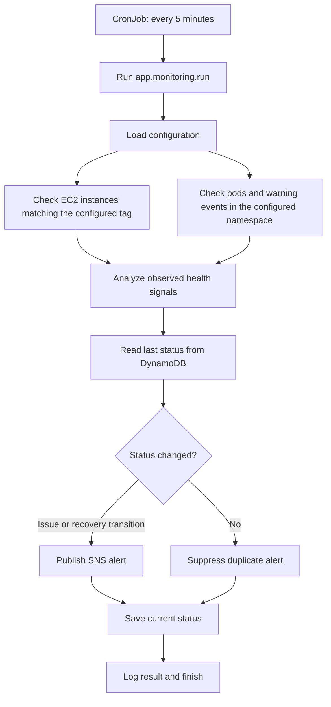

# Enterprise RAG Chatbot and DevOps Health Monitor

This repository contains a FastAPI application, AWS/Kubernetes DevOps health checks,
and an optional scheduled monitor for EC2 and Kubernetes pods.

## What is included

- FastAPI app and OpenAPI docs.
- Chat route compatibility: `/api/get_response` and `/api/public/get_response`.
- Ingestion route contract: `/api/load_data` for S3/GitHub source requests.
- Existing evaluation route names: STS, ROUGE and sentiment.
- Health endpoints for container health checks.
- Audio/image upload contracts. Server-side microphone/webcam capture has been removed;
  browser/device media must be uploaded by the client.
- Dockerfile, environment template and basic API tests.
- Authenticated DevOps planning and on-demand health-check endpoint.
- Five-minute Kubernetes CronJob for health checks and SNS notifications.

## Important current limitation

Chat retrieval and Bedrock response generation are not yet connected; the chat endpoint
returns HTTP 503 until that RAG flow is implemented.

The destructive legacy routes (`/api/delete_index`, `/api/undeploy_index`, and
`/api/delete_bucket`) are **not exposed**. They must be replaced with tightly authorized
administrative operations only if there is a real operational need.

## Run locally (Windows PowerShell)

```powershell
py -3.11 -m venv .venv
.\.venv\Scripts\Activate.ps1
python -m pip install --upgrade pip
pip install -r requirements.txt
Copy-Item .env.example .env
uvicorn app.main:app --reload --host 127.0.0.1 --port 8000
```

Open `http://127.0.0.1:8000/docs`.

## On-demand health check

The agent can inspect tag-matched EC2 instances and Kubernetes pods in one
configured namespace. It reports observed signals and possible causes, not a
confirmed root cause. It does not read pod logs.

```powershell
curl.exe -X POST http://127.0.0.1:8000/api/agent/run `
  -H "Content-Type: application/json" `
  -H "X-API-Key: <your-devops-agent-api-key>" `
  -d '{ "prompt": "Check EC2 and Kubernetes health", "action": "check_health", "environment": "development", "region": "us-east-1" }'
```

Set `GEMINI_API_KEY` and a strong `DEVOPS_AGENT_API_KEY` in `.env` for the
authenticated agent endpoint. All actions are explicit request values; model
output cannot choose or authorize a tool. EC2 stop is disabled unless explicitly
allowlisted and limited to instances matching the configured tag.


#### Input

{
  "prompt": "Check EC2 and Kubernetes health",
  "action": "plan",
  "environment": "development",
  "region": "us-east-1"
}


{
  "prompt": "Check CPU usage",
  "action": "get_instance_cpu",
  "environment": "development",
  "region": "us-east-1",
  "target_instance_id": "i-4d6Abf4d4Fb34"
}
```
## Continuous monitoring

The Kubernetes CronJob runs a one-shot, read-only check every five minutes:



The monitor sends an SNS alert on a status transition and a recovery alert when
health returns. DynamoDB stores the prior state to suppress repeated alerts.
It never performs remediation.

### Enable the scheduled monitor

1. Apply Terraform and retrieve the SNS topic and DynamoDB table:

   ```powershell
   terraform -chdir=infrastructure/terraform apply
   terraform -chdir=infrastructure/terraform output -raw devops_alerts_sns_topic_arn
   terraform -chdir=infrastructure/terraform output -raw devops_monitor_state_table_name
   ```

2. Subscribe to the SNS topic and confirm the subscription:

   ```powershell
   aws sns subscribe --topic-arn <topic-arn> --protocol email --notification-endpoint <email-address>
   ```

3. Build and push the image. In `k8s/devops-health-monitor-cronjob.yaml`, set
   the real image, EC2 tag, SNS ARN, and DynamoDB table. Replace every
   `REPLACE_WITH_...` value.
4. Apply the namespace-scoped, read-only Kubernetes permissions and CronJob:

   ```powershell
   kubectl apply -f k8s/devops-agent-rbac.yaml
   kubectl apply -f k8s/devops-health-monitor-cronjob.yaml
   kubectl get cronjob devops-health-monitor
   kubectl get jobs
   ```

The application IAM role requires EC2 describe, SNS publish, and DynamoDB
get/put permissions for the monitor. Terraform defines those permissions and
resources in `infrastructure/terraform/app-iam.tf`. If the namespace changes,
update the Role and RoleBinding in `k8s/devops-agent-rbac.yaml` as well.

## Run tests

```powershell
pip install pytest httpx
pytest -q
```

## Run with Docker

```bash
docker build -t enterprise-rag-fastapi:phase1 .
docker run --rm -p 8000:8000 enterprise-rag-fastapi:phase1
```

## Endpoint notes

| Method | Endpoint | Phase 1 behavior |
|---|---|---|
| GET | `/health/live` | Functional liveness check |
| GET | `/health/ready` | Reports configured dependency identifiers |
| POST | `/api/agent/run` | Authenticated planning, on-demand EC2/Kubernetes health diagnosis, and configured EC2 stop |
| POST | `/api/get_response` | Validates request; returns 503 until AWS RAG adapter exists |
| POST | `/api/public/get_response` | Compatibility route; do not expose publicly before auth/rate limits |
| POST | `/api/load_data` | Validates S3/GitHub ingestion request; returns 503 until adapter exists |
| POST | `/api/get_sts_score` | Optional evaluation dependency |
| POST | `/api/get_rouge_score` | Optional evaluation dependency |
| POST | `/api/get_sentiment_analysis` | Optional evaluation dependency |
| POST | `/api/get_transcript` | Audio upload contract; Transcribe adapter pending |
| POST | `/api/record_voice` | Audio upload contract, not server microphone recording |
| POST | `/api/image_analysis` | Image upload contract; Bedrock multimodal adapter pending |

## Security

The uploaded original `constants.py` contained a Google API key and a service-account file
reference. Treat the exposed key as compromised: revoke/rotate it in Google Cloud and rotate
any related service-account credentials. Do not copy those credentials into this project.
Use workload IAM roles for AWS permissions and keep secrets out of source control.
